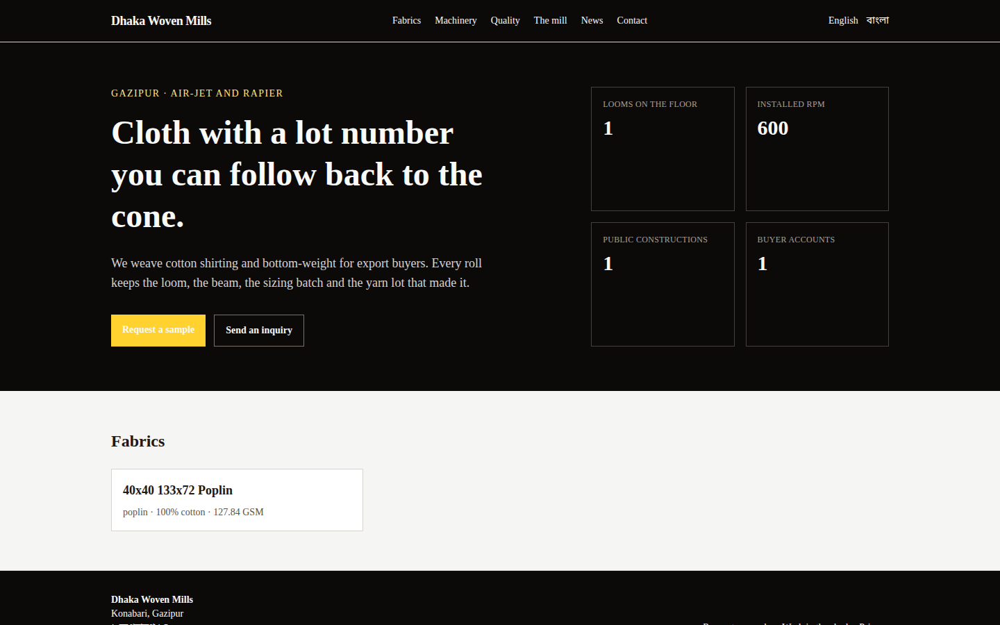
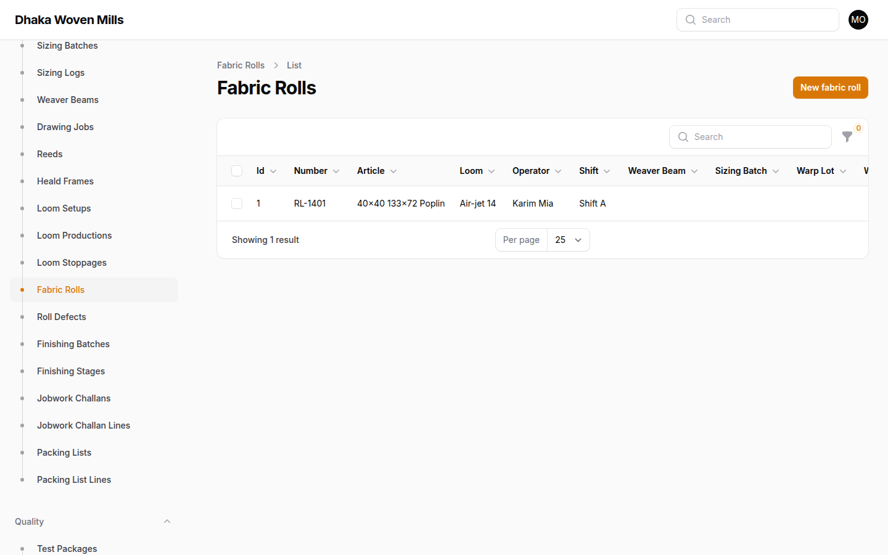
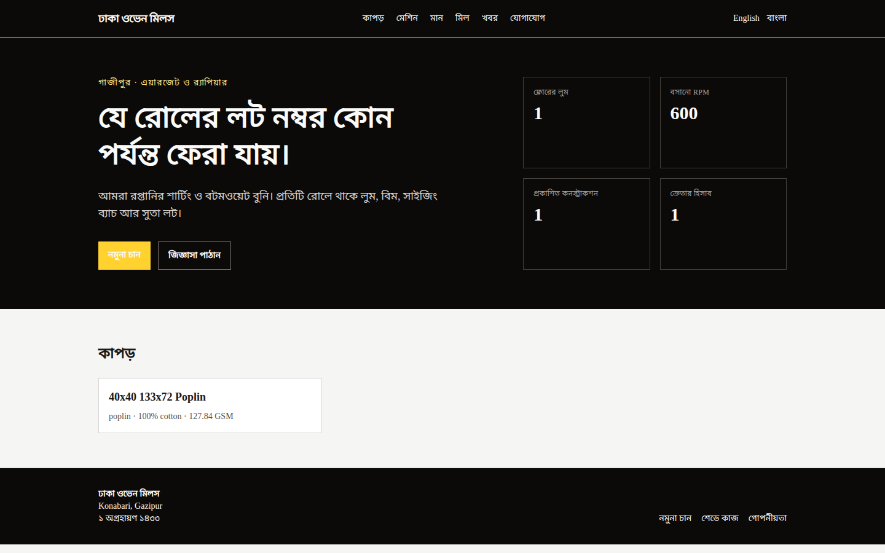
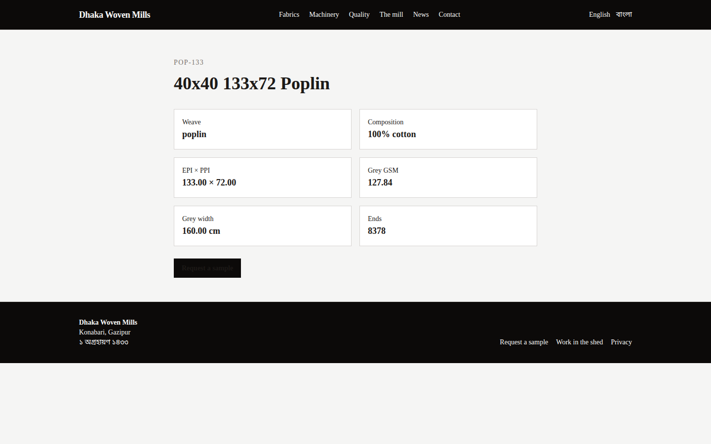
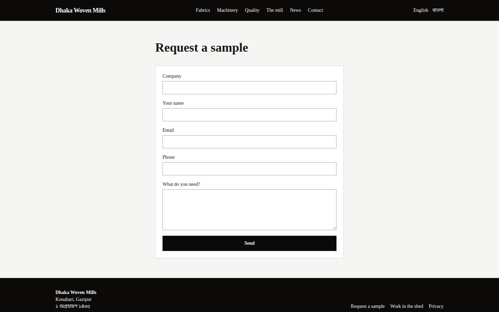
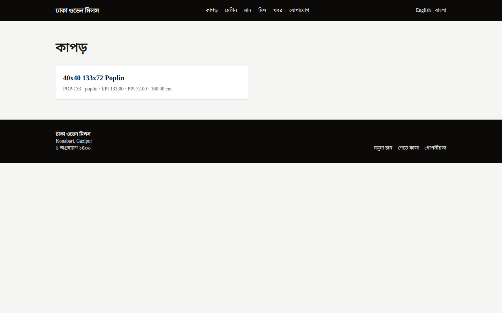
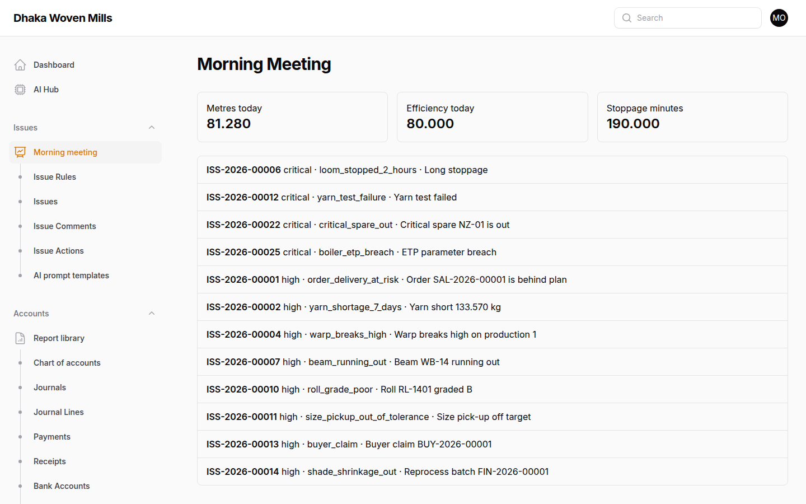
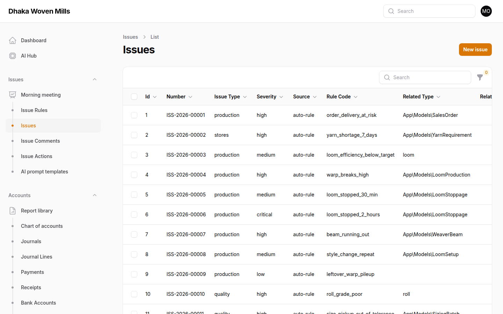
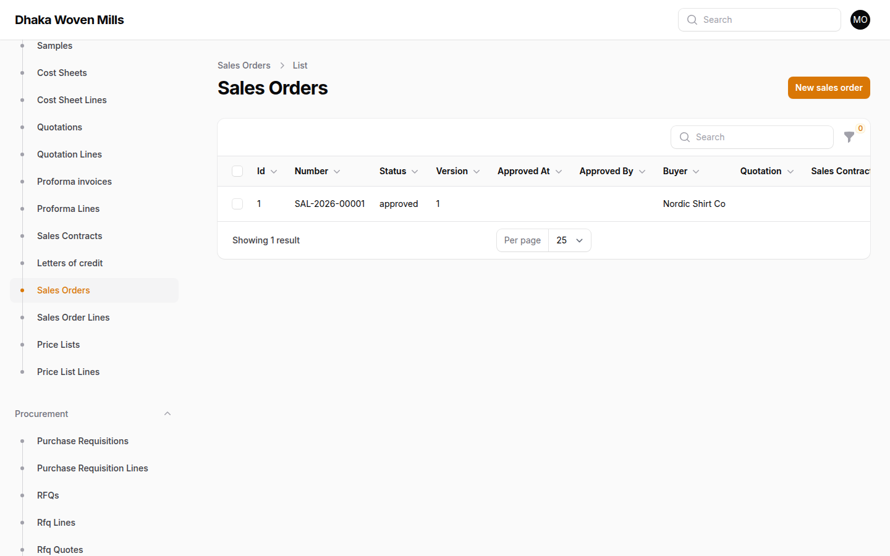

# Dhaka Woven Mills

A woven-fabric mill, from the buyer’s first sample request to the taka in the bank, with the roll number still pointing at the yarn lot.

Built for shuttleless weaving in Bangladesh — air-jet, rapier, projectile, and the preparatory shed in front of them — and configurable for another country, currency, tax form and language. English and Bangla are both first-class.

Developed by [Imran Ahmed](https://imrandev.bd).

<p align="center">
  
</p>

The screenshot is the seeded Gazipur mill, not a mock. One air-jet is on the floor, the public construction is a 40×40 133×72 poplin, and the technical sheet has already done the arithmetic: **8,378 ends**, **127.84 GSM**.

## What you get

A mill that still runs on challans, beam cards and a month-end spreadsheet can keep that process. This system gives every one of those papers a screen, then removes the slow parts:

- A roll number opens the loom, the operator, the beam, the sizing batch and both yarn lots.
- A second yarn lot cannot be issued onto the same warp unless someone approves the mix.
- An order that is late, a beam that is about to run out, a size pick-up that drifted, a yarn test that failed, an LC that is about to expire — each one becomes an issue with an owner and a clock. Thirty-five of those rules ship with the mill. The morning meeting opens on them.
- Yarn, grey, finished cloth, chemicals and spares are separate stores. Nothing is issued to the shed without a job card.
- Money is posted once, through a double-entry service. A journal that does not balance is refused. A locked month is refused. Production metres, inspected metres and invoiced metres are the same figure, and the yarn account matches the kg still in the store.
- The public site, the buyer portal, the supplier portal and the floor kiosk are the same database. A sample request on the website is a lead and an inquiry before anyone retypes the email.

## Time back

These are planning figures for one weaving unit the size of the demo, not a survey. They are the hours a shed already spends copying books, and the place that copying stops.

| The job today | What changes | Time you stop spending |
|---|---|---|
| The weaving manager collects three shift books before the morning meeting | Metres, efficiency, stoppage minutes and the critical issues are already on the screen | About an hour, every morning |
| A buyer claim arrives and someone hunts the beam card, the sizing log and the yarn challan | The roll number opens that chain | A file that used to take a day or two starts the same morning |
| Planning promises a date from Excel, a phone call to the store, and another to accounts | Feasibility returns the shortage and the earliest date on the order | An afternoon of calls becomes one check |
| The store trusts cone colour and two lots go onto one warp | The issue is blocked. The shade claim three months later is the expensive version of this row | The claim, not the minute |
| The last three days of the month are production versus stock versus the ledger, on paper | Those three quantities are forced to agree as the cloth moves | The reconstruction at month end |
| An inquiry arrives by email and is copied into a register | The form creates the lead, the inquiry and the sample request | The retyping |
| The gate and the office each write the same challan | A QR gate pass. No pass, no movement | The argument at the gate |
| PM, air pressure, ETP, LC expiry and overtime limits live in someone’s memory | A rule opens an issue, names the role, and starts the SLA | The item that used to expire in silence |

Across a weaving office, that is on the order of **15–25 hours a week** of chasing and copying, before counting the claims, the re-dyes and the late shipments that the rules are there to catch earlier. A mixed yarn lot or a beam that runs out mid-order costs more than the clerk’s afternoon.

## The cloth, end to end

The seeded mill walks one poplin order the way the shed already walks it.

1. A lead and an inquiry, then a handloom sample the buyer approves.
2. A cost sheet: yarn, size, weaving, process, overhead, finance and commission, with a yarn-price sensitivity. The quoted rate carries the target margin.
3. Quotation, proforma, contract, export LC, and a back-to-back LC so the utilisation is visible.
4. A sales order with a delivery date. Feasibility checks yarn, credit and the loom.
5. A production plan, the warp kilograms, and a job card for warping and another for weaving.
6. Yarn received against the purchase order, held if the lab has not released it, then issued. The creel records which lot sat in which position.
7. Section beam, sizing batch with target and actual pick-up, weaver’s beam, reed, healds, drawing-in.
8. Three shifts on loom L-14. Picks become metres. Efficiency is actual picks divided by RPM times minutes. Stoppages are coded, including the ones nobody coded.
9. Grey inspection. Roll **RL-1401** is graded, and the defect sits on a metre mark.
10. Job-work finishing, with the process loss and the reprocess flag.
11. Packing list, dispatch, export invoice, receipt, and a gate pass for the truck.
12. The ledger: yarn in, yarn to production, sale, collection. Order profit sits next to the standard cost.

<p align="center">
  
</p>

Roll RL-1401 is on air-jet 14, woven by Karim Mia on shift A. Behind that row are the weaver’s beam, the sizing batch, warp lot WL-19 and weft lot WF-07.

## Look through it

The same page in Bangla. Live counts come from the machines and the articles, not from a brochure. The date in the footer is the Bangladesh calendar. 14 April 2026 is 1 Boishakh 1433. The day this mill was seeded read ১ অগ্রহায়ণ ১৪৩৩.

<p align="center">
  
</p>

Each public construction has its own page: weave, composition, EPI, PPI, GSM, width and ends. The ends and the GSM are calculated when the article is saved, not typed.

<p align="center">
  
</p>

A buyer asks for a sample on the site. The form creates a lead, an inquiry and a sample request. A honeypot and a rate limit sit in front of it. Careers and price requests do the same for a job application and an RFQ.

<p align="center">
  
</p>

The catalogue in Bangla, for the buyer who reads the site in either language.

<p align="center">
  
</p>

Monday morning. Yesterday’s metres, the efficiency, the stoppage minutes, and the issues that cannot wait: a loom stopped two hours, a yarn lot that failed the lab, a critical nozzle out of stock, an ETP reading outside the limit, an order already late, a warp shortage of 133.57 kg, beam WB-14 running out, roll RL-1401 graded B.

<p align="center">
  
</p>

The issue board those rows come from. Every rule in the mill is visible, filterable, and assigned.

<p align="center">
  
</p>

The order that started it. Nordic Shirt Co, approved, linked back through the contract and the LC.

<p align="center">
  
</p>

## Modules

The admin panel is one menu per department. Each record has a number series, a status, an audit trail, and a policy. Cost, rate, wage and ledger amounts stay hidden from roles that do not price cloth.

### Marketing and the order

Leads, inquiries, visits, meetings, follow-ups. Sample requests and the buyer’s comment on the sample. A cost sheet with scenarios. Quotation, proforma, sales contract, master LC and back-to-back LC. Sales orders with shade, width, quantity, rate, tolerance and a delivery line. Buyer price lists. Feasibility stored on the order: earliest date, shortages, credit, margin.

### Planning

The plan sits on the sales order. Yarn requirement is warp and weft kilograms from the technical sheet, minus what the store can release. Beam plan, loom allocation, and a job card per stage with a barcode. A nightly check can raise an issue when cumulative production falls behind the plan.

### Yarn, import and the store

Requisition, RFQ, ranked quotes, purchase order. Shipments, bills of entry, and a landed cost that adds freight, insurance, duty, port and C&amp;F onto the lot and divides by the kilograms. Supplier claims and a scorecard.

Separate stores for yarn, chemicals, spares, packing, grey, finished cloth and the rest. A receipt can sit in quarantine until the lab releases it. Issue, return and transfer. Stock is valued with a decimal quantity and a decimal cost, never a float. Reorder level, expiry, a count variance and an overdue purchase order each open an issue. A scanner API receives and issues by barcode.

### Preparatory and weaving

Warping, with the lot written against the creel position. Section beams. Sizing recipes and the batch log: viscosity, concentration, pick-up target against actual, moisture, stretch, steam, squeeze. A pick-up outside tolerance holds the story on the beam and opens an issue. Weaver’s beams and the leftover warp that piles up in the store. Drawing-in or tying-in, reeds and heald frames as their own stock. Loom setup, including the repeated style change.

Weaving production from the floor kiosk, from a scan, or from a loom-monitor file. Efficiency, metres from picks and PPI, warp breaks, weft breaks. Stop reasons on large buttons, labelled in Bangla. Piece-rate wages from the metres, ready for payroll.

### Grey, finishing, packing

Inspection on the 4-point or the 10-point system. Defects by metre, points, and a grade: A to 20 points per 100 square yards, B to 28, C to 40, then reject. The 10-point scale uses 20 / 30 / 40. Photos can sit on the defect. The grade is traced to the loom, the beam and the lot.

Finishing can be switched per branch. In-house stages or a job-work party, with grey sent out, finished metres received, process loss, and a reprocess when the shade or the shrinkage misses. Packing lists, carton marks, and the roll’s place in the order.

### Laboratory

Yarn count, strength, evenness, neps. Size viscosity and pick-up. Grey construction. Finished shrinkage, GSM, strength, pilling, fastness, against a buyer’s limit table. A failed yarn lot opens an issue and can draft the supplier claim. Instruments carry a calibration date. Buyer claims link to the roll and, through it, to the cause.

### Maintenance and utilities

Assets, manuals, warranties. Preventive maintenance by calendar or by running hours. A breakdown raised from a stoppage, with the mechanic, the downtime, the spare consumed and the cause. The same fault three times in thirty days is its own issue. Critical spares at zero open an urgent requisition. Power, compressed air, steam, water, generator hours. Energy per metre. ETP inlet and outlet, sludge, and a breach of the limit. Annual maintenance contracts.

### Dispatch and the gate

Dispatch advice, challan, commercial invoice, packing list, Mushak form code when the country needs one. Export document checklist against the LC: a present document that does not match the credit is an issue. Gate in and gate out, vehicle, driver, weights, QR token, returnable or not. Visitors, security rounds, incidents.

### Accounts and the cost of a metre

Chart of accounts seeded for a textile mill. Journals, receipts, payments, cheques and post-dated cheques, bank reconciliation, fixed assets and depreciation, budgets, tax lines, loans. Multi-currency amounts carry a rate.

Only `PostingService` writes journal lines. The demo posts the yarn receipt, the issue to production, the export invoice and the collection. Accounts receivable clears. Yarn inventory in the ledger equals the kilograms left in the store, at the lot cost.

Order cost is the other view of the same cloth: yarn, sizing, weaving, finishing, packing, wastage and overhead, per metre, next to the revenue. A loss against the standard opens an issue for the accounts manager.

The report library runs 101 reports: production, efficiency, rolls, issues, invoices, yarn stock, stoppages and defect points, across today, the month, the loom, the article, the shift, the buyer and the other cuts the shed actually uses, plus trial balance, profit and loss, order profit, and the stock-to-ledger tie.

### People

Employees, grades, skills. Attendance, leave, and a piece-rate payroll run from the loom metres, with overtime. Payslips are Unicode PDFs, so the Bangla prints. Compliance documents expire into an issue. Accidents and grievances are records, not a conversation that was never written down. Overtime past the weekly legal limit, a biometric terminal that has gone quiet, and a spike in absentees each raise an issue.

### The issue engine

An issue has a number, a severity, a source, the record it is about, a department, an assignee, an escalation step, and a status that runs from open through acknowledged, investigating, action taken and verifying, and on to closed. Root cause, corrective action, preventive action, cost, comments and a timeline sit on it.

The rules that ship with the mill:

| | | |
|---|---|---|
| Order behind plan | Yarn short for the next week | Loom efficiency under target for three shifts |
| Warp breaks too high | Loom stopped 30 minutes with no reason | Loom stopped two hours |
| Beam about to run out | The same style change, again | Leftover warp piling up |
| Roll graded B, C or reject | Size pick-up off target | Yarn test failed |
| Buyer claim | Shade or shrinkage out | Reorder level |
| Chemical near expiry | GRN sitting in quarantine | Stock-count variance |
| Purchase delivery overdue | Preventive maintenance overdue | The same breakdown, three times |
| Critical spare at zero | Energy per metre jumped | Compressor pressure low |
| Boiler or ETP breach | LC near expiry | Back-to-back limit over 90% |
| Order losing money | Export document does not match the LC | Buyer over the credit limit |
| Bank reconciliation not done | Overtime over the legal week | Attendance terminal offline |
| Certificate expiring | Absenteeism spike | |

SLA clocks run by severity. The same cause on the same machine is visible as a repeat, not as a new surprise. Suggestions from past issues stay suggestions. Nothing destructive is posted by a model.

## Who signs in

| Place | Who |
|---|---|
| `/admin` | The mill. Owner, directors, weaving, preparatory, quality, stores, purchase, maintenance, commercial, accounts, HR, compliance, IT. |
| `/buyer` | The buyer, and the merchandiser sitting with them. Orders for the party whose email matches the login. |
| `/supplier` | The supplier, and the purchase manager. Their purchase orders. |
| `/floor` | Operator, supervisor, weaving manager, inspector, mechanic. Large stop buttons, Bangla labels, picks for the shift. |
| `/` | Anyone. Catalogue, machinery, quality, the mill, news, sample, price, careers, contact. |
| `/shell` | The packaged operations shell, separate from the ERP so the two do not fight over `/admin`. |

Demo passwords are `password`. Change them before this is reachable from outside the office.

| Person | Email |
|---|---|
| Owner | `owner@mill.test` |
| Weaving manager | `weaving-manager@mill.test` |
| Loom operator | `loom-operator@mill.test` |
| Buyer | `buyer@mill.test` |
| Supplier | `supplier@mill.test` |
| Accountant | `accountant@mill.test` |

Accountant, accounts manager, auditor and commercial manager are marked for an authenticator. The demo secrets are already confirmed so the panel opens. `/admin/two-factor` is the setup screen. An allow-list of exact office IPs can be set with `ADMIN_IP_ALLOWLIST`. Empty means every address.

Field-level hiding covers rates, costs, wages and ledger amounts. Owner, managing director, accounts, auditor, commercial, merchandiser and IT see them. Anyone else needs the `view-costs` permission.

## What the mill will also stretch to

The data model is already multi-branch and multi-unit. A second shed is another branch, with its own number series, its own warehouses and its own fiscal period. Finishing can be on in one branch and off in another.

Currency defaults to taka. Export documents can be in dollars, with a rate on the journal line. Tax rules carry a form code, so Mushak is a configuration, not a hard-coded print.

The loom monitor API accepts a file of loom code, picks and PPI. The floor API accepts a shift’s picks and a stoppage. The gate API accepts the QR token. The warehouse API receives into quarantine. A buyer token reads that buyer’s orders. Interactive API docs are at `/docs/api`.

PDFs — invoice, challan, gate pass, inspection, payslip, packing list, cost sheet — go through Unicode PDF, so Bangla and English share the page.

AI hooks are present and switched off until a provider key exists: prompt templates in the database, OCR for a challan or a bill of entry, and a catalogue assist for a fabric photo. A person confirms before anything is posted. The model does not write the ledger.

## Stack

Laravel 12, PHP 8.3+, Filament 3, Livewire, Tailwind. MySQL 8 in production. SQLite for the laptop and the tests, because the arithmetic does not care. Redis for cache, session and the queue when you turn Horizon on. Sanctum for the apps. Pest for the tests.

Quantities are 3 decimal places, rates 4, money 2, all through a decimal library. Dates are stored in UTC and shown in Asia/Dhaka.

Packages from [imrandevbd](https://packagist.org/users/imranbru99/packages/) are used where they fit: the admin shell, the AI hub, OCR, the catalogue assist, Unicode PDF, slugs, attendance devices, Filament’s master-data generator, Tarikh for dates, and Drutogoti for query tuning. Where a package is unpublished or missing a mill rule, the gap is written down in [docs/package-gaps.md](docs/package-gaps.md) and a thin adapter covers it. Spatie’s permission package is not installed. Activity is.

## Run the demo

```bash
composer install
npm install
npm run build
cp .env.example .env
php artisan key:generate
php artisan migrate
php artisan db:seed
php artisan serve
```

Then open `/` and `/admin`.

`php artisan mill:evaluate-issues` runs the rules again. The scheduler runs them at 06:00 Asia/Dhaka when cron calls `schedule:run`. Horizon consumes the queue in production.

The tests cover the technical sheet, the blocked yarn mix, a locked fiscal period, the full order through to cash, all 35 rules, the report library, and the public forms.

```bash
php artisan test
```

## Further reading

- [Decisions](docs/decisions.md) — why Filament 3, why SQLite locally, why the ledger has a single door.
- [Package gaps](docs/package-gaps.md) — what the published packages do not cover yet.
- [Modules and roles](docs/modules.md) — where each screen lives.
- [Deployment](docs/deployment.md) — one VPS, PHP-FPM, MySQL 8, Redis, Horizon, the scheduler, backup and restore.

## Licence

[MIT](LICENSE). Copyright (c) 2026 IMRAN Dev BD. The Laravel skeleton this mill starts from is MIT as well.

## 🤝 Let's Connect & Collaborate

I am open to Senior Remote Full-Stack Roles, AI Platform Architecture Contracts, and Enterprise Technical Advisory.

**Timezone:** UTC+6 (Dhaka / Rangpur, Bangladesh) — Flexible overlap with US, UK, and European business hours.

**Delivery Mode:** Async-ready, Slack, Discord, Jira, GitHub, and production-first accountability.

| Channel | Address / Handle | Quick Action |
|---|---|---|
| 🌐 Primary Portfolio | [imrandev.bd](https://imrandev.bd) | [Visit Site ↗](https://imrandev.bd) |
| 📦 Packagist Packages | [packagist.org/packages/imrandevbd/](https://packagist.org/packages/imrandevbd/) | [View Packages ↗](https://packagist.org/packages/imrandevbd/) |
| 💼 LinkedIn Profile | [linkedin.com/in/imranbru99](https://www.linkedin.com/in/imranbru99) | [Connect ↗](https://www.linkedin.com/in/imranbru99) |
| 🐙 GitHub Profile | [github.com/imranbru99](https://github.com/imranbru99) | [Follow ↗](https://github.com/imranbru99) |
| 💬 WhatsApp Direct | [+880 1576-918420](https://wa.me/8801576918420) | [Chat Now ↗](https://wa.me/8801576918420) |
| 📧 Direct Email | [me@imrandev.bd](mailto:me@imrandev.bd) | [Send Email ↗](mailto:me@imrandev.bd) |
| 🐦 X (Twitter) | [@imrandev_bd](https://x.com/imrandev_bd) | [Follow ↗](https://x.com/imrandev_bd) |
| 📺 YouTube Tech | [@ImranDevBD](https://www.youtube.com/@ImranDevBD) | [Subscribe ↗](https://www.youtube.com/@ImranDevBD) |
